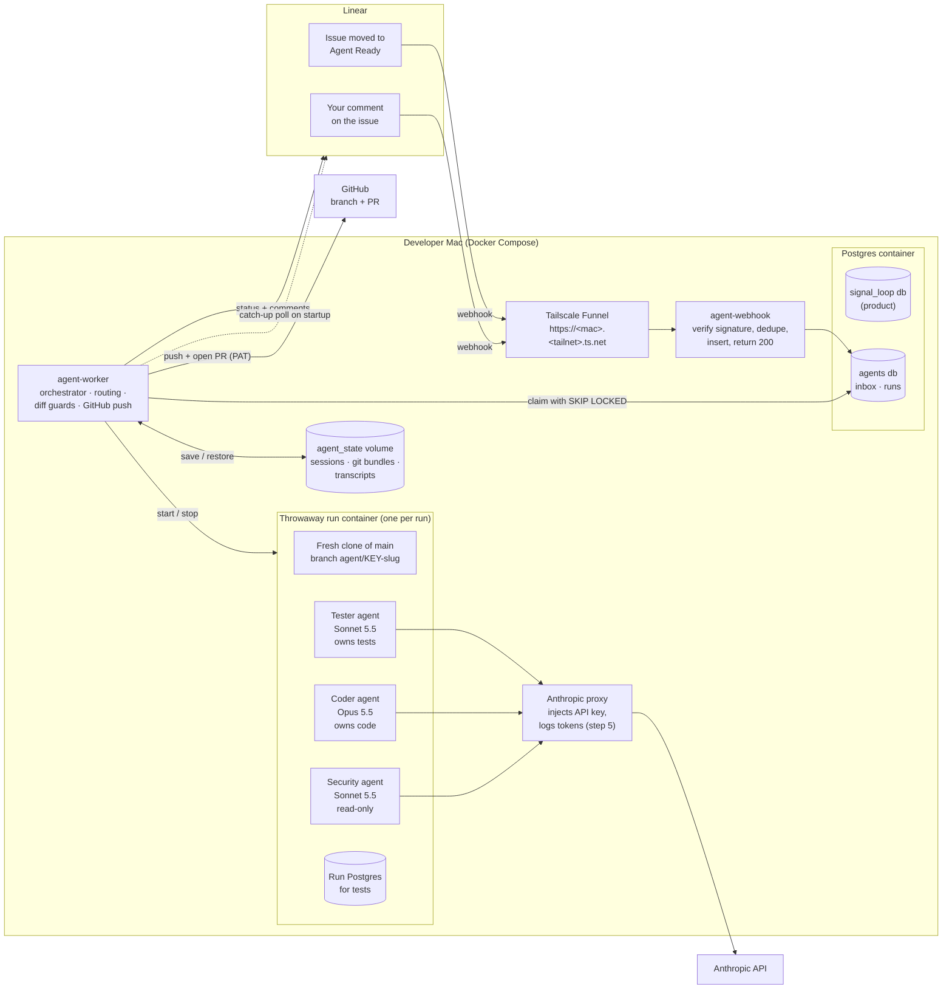
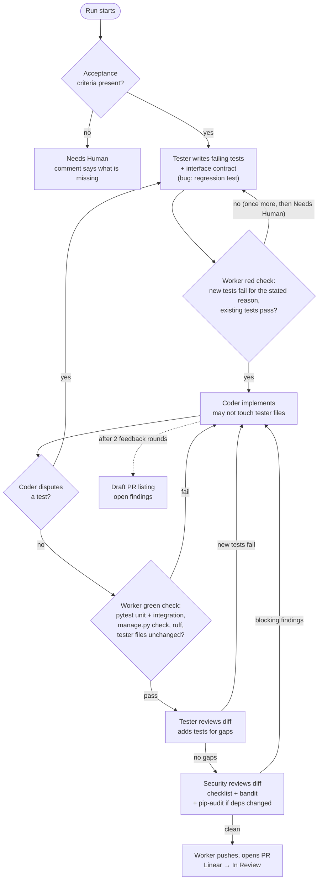

# Signal Loop agents: design

An always-on agent system that picks up Linear issues, writes tests first, implements the change, reviews it for security, and opens a pull request against this repository.

It follows the model in [Building always-on agents](https://claude.com/resources/articles/building-always-on-agents). The agent is not literally running all the time. It sleeps, wakes for a short **run** when an event lands in a durable **inbox**, saves its state, and sleeps again.

This is a prototype. It runs locally in Docker on the developer's Mac and lives in this repository until it earns a repository of its own.

## Architecture

Key boundaries:

- **The agents never hold a GitHub token.** They commit inside their container. The worker pushes and opens the PR after its own checks pass.
- **The Anthropic API key stays out of the run container** once the proxy lands in step 5. Until then it is passed in as an environment variable.
- **The product database is untouched.** The harness has its own `agents` database on the same Postgres server, and each run gets its own throwaway Postgres for tests.

## Pipeline

Every return to the coder, whether from a test dispute, a tester gap, or a security finding, uses one of the **2 feedback rounds** for the issue. After that the worker opens a draft PR that lists what is still open.

## Decisions

### Location and runtime

- The harness is a standalone Python package in `agents/` with its own `pyproject.toml`, built on the Claude Agent SDK. It is not a Django app, so its tables never enter the product's migrations.
- Docker Compose gains two services, `agent-webhook` and `agent-worker`, and an `agents` database on the existing Postgres container.
- The queue is a plain Postgres table claimed with `SELECT … FOR UPDATE SKIP LOCKED`. Celery, with Redis as its broker, runs the worker: beat checks the table every few seconds and fails tasks whose lease expired. Task state lives only in the table.

### Triggers and the inbox

- A run starts when a Linear issue moves to **Agent Ready**.
- Linear webhooks reach the Mac through **Tailscale Funnel**, which gives a stable public HTTPS URL. Funnel must be enabled for the machine in the tailnet policy, with MagicDNS and HTTPS certificates on, on port 443, 8443 or 10000.
- The webhook handler verifies Linear's signature, dedupes on the delivery ID, inserts an inbox row and returns immediately. No agent work happens in the handler.
- On startup the worker polls Linear for issues in **Agent Ready** that have no inbox row, so nothing is lost while the Mac sleeps.
- Later edits to an issue, and comments on it, become new inbox events for that issue.
- **Only comments from the developer's Linear user ID count as input.** The agent's own comments are ignored so they cannot trigger it again. Comments from anyone else are logged and ignored.
- One worker runs one run at a time. The queue enforces at most one active run per issue, so more workers can be added later without a redesign.

### Issue contract and statuses

An issue is ready for the agent when it has:

| Section | Feature | Bug |
| --- | --- | --- |
| Goal | required | — |
| Steps to reproduce, Expected / Actual | — | required |
| Acceptance criteria (checklist) | required | required |
| Interface (endpoints, payloads, status codes, errors) | optional | optional |
| Out of scope | recommended | recommended |
| Notes / links | optional | optional |

The **Feature** and **Bug** labels tell the pipeline which kind of issue it is. If acceptance criteria are missing, the agent comments what is missing and moves the issue to **Needs Human** without spending tokens on coding.

Statuses: **Agent Ready** → **Agent Working** → **In Review** (a comment links the PR) or **Needs Human** (a comment explains why). The agent comments only when a step finishes, never in a stream.

### Run isolation

- Each run gets a **throwaway Docker container** with a fresh clone of `main` on the branch `agent/<ISSUE-KEY>-<slug>`, plus its own temporary Postgres for tests.
- The container is destroyed when the run ends. The branch is the only thing kept.
- Naming the branch after the issue key lets Linear's GitHub integration link the PR to the issue on its own.

### Agents and handoffs

Each agent gets a **fresh SDK session** in the same container and working tree, and finishes with a **structured JSON verdict**. The worker reads the verdicts and decides what runs next. The routing is ordinary code, not a model.

| Agent | Model | Writes | Verdict |
| --- | --- | --- | --- |
| Tester | Sonnet 5.5 | tester-owned paths only | tests added (unit / integration), interface contract, expected failure reason per test, gaps found |
| Coder | Opus 5.5 | everything except tester-owned and protected paths | summary, files changed, test disputes |
| Security | Sonnet 5.5 | nothing (read-only) | findings with severity and a blocking flag |

### Tests first

- **The tester writes the tests before any code exists**, working from the acceptance criteria. For a bug, it first writes a regression test that reproduces the bug on current `main`. If it cannot reproduce the bug, it comments what it tried and moves the issue to **Needs Human**.
- **The tests call public behaviour**, mostly HTTP endpoints through Django's test client, not internal functions or classes. The tester's verdict includes an **interface contract** the coder must follow. If the issue has an Interface section, the tester uses it. If it is blank and the choice is unclear, the tester asks in Linear.
- **Red check:** after the tester's commit, every new test must fail for the reason the tester stated, and every existing test must pass. A syntax or import error does not count as the expected failure. If the check fails, the work goes back to the tester once, then to **Needs Human**.
- **The tester owns** `**/tests/**`, `test_*.py`, `conftest.py`, and test factories and fixtures. **The coder owns** everything else, including migrations and settings. The coder writes no tests.
- This is enforced twice. A hook blocks the coder from writing to tester-owned paths. The worker also checks that every tester-owned file is byte-for-byte unchanged between the tester's commit and the coder's commit. If anything changed, the run fails and no PR is opened.
- **Test disputes:** if the coder believes a test is wrong, its verdict names the test, why it is wrong and the acceptance criterion it contradicts. The tester either fixes the test or keeps it with an explanation. A second dispute on the same test goes to the developer in Linear.
- **Gap review:** once the suite passes, the tester reviews the coder's diff once and may add tests for cases the criteria imply, such as error paths and permission checks.
- **Test layers:** unit tests cover functions and model logic on their own, using Django's `SimpleTestCase` where possible. Integration tests use Django's test client against the run's real Postgres. External APIs such as OpenAI are always faked. The runner is **pytest + pytest-django** with `unit` and `integration` markers, so the worker can report each group separately.
- **Green check:** `pytest` (both markers), `manage.py check`, `ruff check` and `ruff format --check`.

### Security review

- A read-only agent reviews the diff against a checklist: OWASP-style checks plus Django-specific ones such as CSRF, raw SQL, file uploads, `DEBUG` and secrets.
- `bandit` runs on changed Python files, and `pip-audit` runs when `pyproject.toml` or `uv.lock` change. Their output goes to the agent to decide which findings matter.
- Blocking findings go back to the coder. The rest are listed in the PR.

### Credentials and self-protection

- **GitHub:** a fine-grained personal access token limited to this repository, with only Contents and Pull Requests write permissions. Only the worker holds it.
- **Anthropic:** an API key with a monthly spend limit set in the Console. From step 5, a small proxy on the worker holds the key. Run containers get `ANTHROPIC_BASE_URL` pointing at the proxy and a placeholder token, and the proxy logs token use per call.
- **Protected paths:** agents may not write to `agents/**`, `.github/**`, `.claude/**` or the agent services in `compose.yaml`. A hook blocks writes, and the worker refuses to open a PR whose diff touches these paths. `CLAUDE.md` at the repository root is deliberately not protected, so agents can propose memory updates to it.

### Cost limits

- A cap of about **$5 per issue**. If it is hit, the issue moves to **Needs Human** with a summary.
- A maximum number of turns per agent.
- A **$50/month** spend limit on the API key as a backstop.

### Pausing, resuming and failures

- When an agent needs a decision, it posts a question as a Linear comment and the run pauses. The worker copies the SDK session file and a `git bundle` of the branch into the `agent_state` volume, keyed by issue, and destroys the container. The developer's reply arrives as an inbox event, and a new container restores both and resumes the same session.
- The same save and restore lets a run survive a crash or reboot.
- Temporary errors (an overloaded API, Docker hiccups, network problems) are retried up to 3 times with increasing waits. After that, or for any other error, the issue moves to **Needs Human** with a description of the error.

### Pull requests

- Title: `<ISSUE-KEY>: <issue title>`.
- Body: a summary, the acceptance criteria checklist with test evidence, security findings, and turns and cost used.
- **Ready for review** when everything is clean, **draft** when findings remain open after 2 feedback rounds.
- The agent never merges.
- To ask for changes, comment on the issue and move it back to **Agent Ready**. The run continues on the same branch and the same PR, adding new commits rather than force-pushing.

### Observability

- A `runs` table records issue, agent, status, turns, tokens, cost and the verdict JSON.
- Full transcripts are saved in the `agent_state` volume.
- A small CLI, `agents status` and `agents show <ISSUE>`, reads both.

### Memory

- Progress on each issue lives in `agent_state`.
- Repo-wide learnings, such as conventions and pitfalls, are proposed as changes to `CLAUDE.md` at the repository root inside the PR, so every change to what the agents believe is reviewed.

## Build order

| Step | Scope | Done when |
| --- | --- | --- |
| 0 | Add `pytest`, `pytest-django` and `ruff` to the product's dev dependencies, configured by hand | `uv run pytest` and `uv run ruff check` run cleanly on `main` |
| 1 | Webhook → inbox → worker → run container → coder → PR | Moving an issue to Agent Ready produces a PR linked to it |

Step 1 is built as an MVP: only moves to **Agent Ready** are stored, the dev agent (`dev_agent.py`) runs once in a throwaway container from the agents image, and the worker (`dev_run.py`) pushes and opens the PR. There is no Linear write-back yet, and tests for runs use the Compose Postgres instead of a Postgres per run.
| 2 | Tester writes tests first, red check, tester-file guard, green check | The coder cannot pass without the tester's tests, and edits to them fail the run |
| 3 | Security agent and the 2-round feedback loop, draft PRs | A blocking finding returns to the coder and an unresolved one yields a draft PR |
| 4 | Pause for questions in Linear and resume from `agent_state` | A question asked mid-run is answered in Linear and the same session continues |
| 5 | Anthropic key proxy and `CLAUDE.md` memory | Run containers hold no real secrets, and memory updates arrive through PRs |

## Setup the developer does by hand

- Install `gh` and Claude Code, and create an Anthropic API key with a monthly spend limit.
- In Linear, create the statuses **Agent Ready**, **Agent Working**, **In Review** and **Needs Human**, the **Feature** and **Bug** labels, and a webhook with a signing secret pointing at the Funnel URL.
- Create the fine-grained GitHub token.
- Enable Funnel for the Mac in the tailnet policy.

## Backlog

- Move the webhook receiver to **EC2**, so events arrive while the Mac sleeps.
- Replace the personal access token with a **GitHub App** for short-lived tokens and a bot identity.
- Start runs from **GitHub PR review comments**, as a second inbox source.
- A **web dashboard** over the `runs` table.
- **Several workers** running in parallel, at most one per issue.
- The article's **"dreaming"** step, which reviews past sessions to curate memory.
- **Linear's native agent delegation** as the trigger instead of a status change.
- Move `agents/` into **its own repository**.
